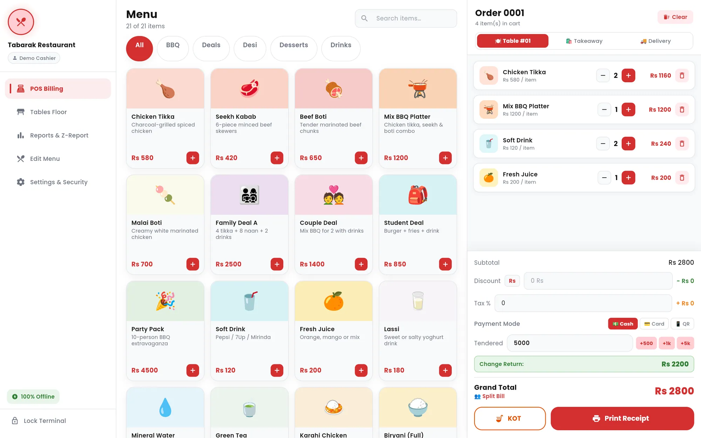
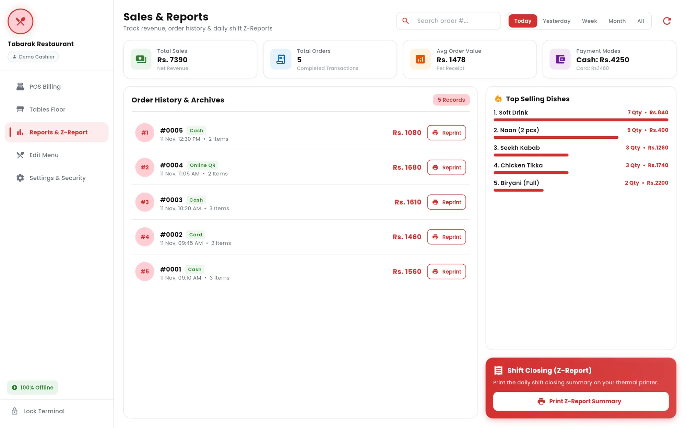
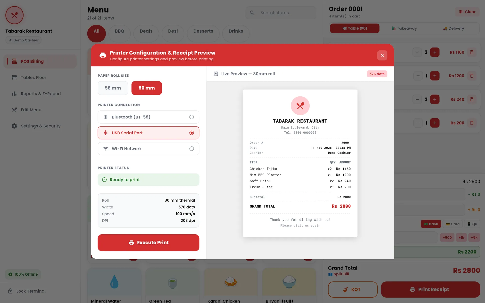
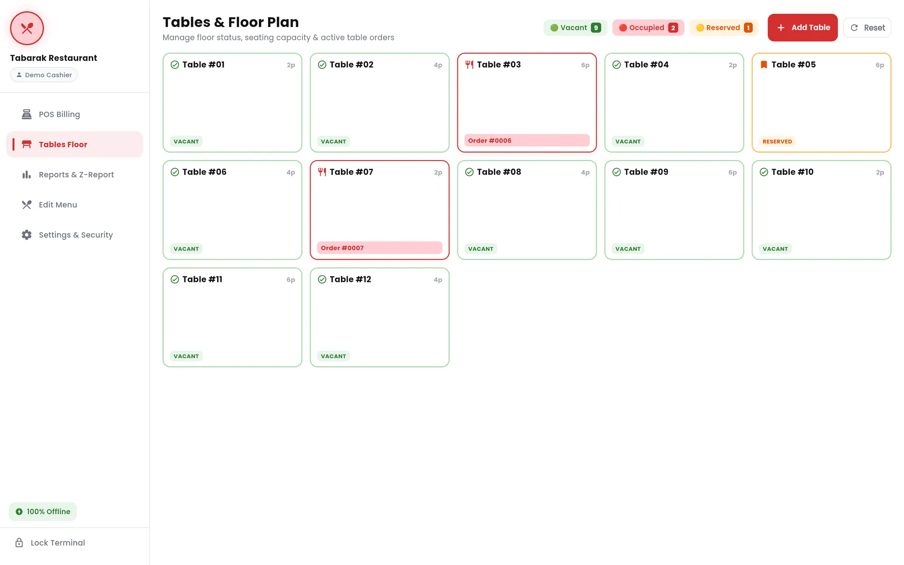
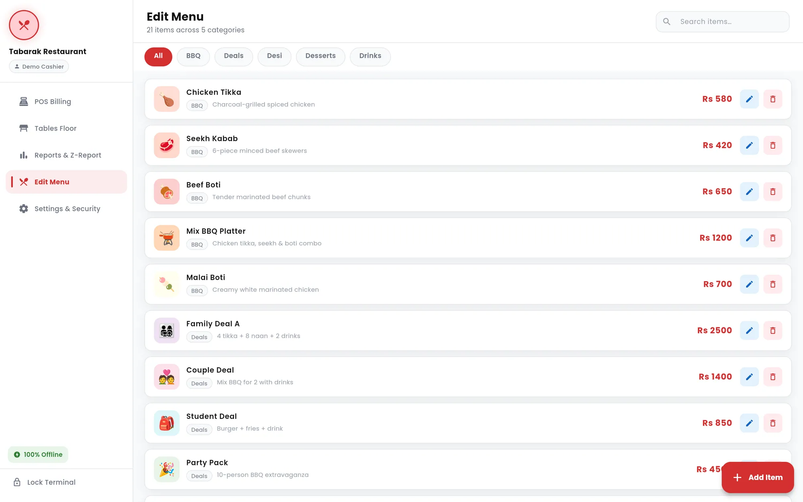
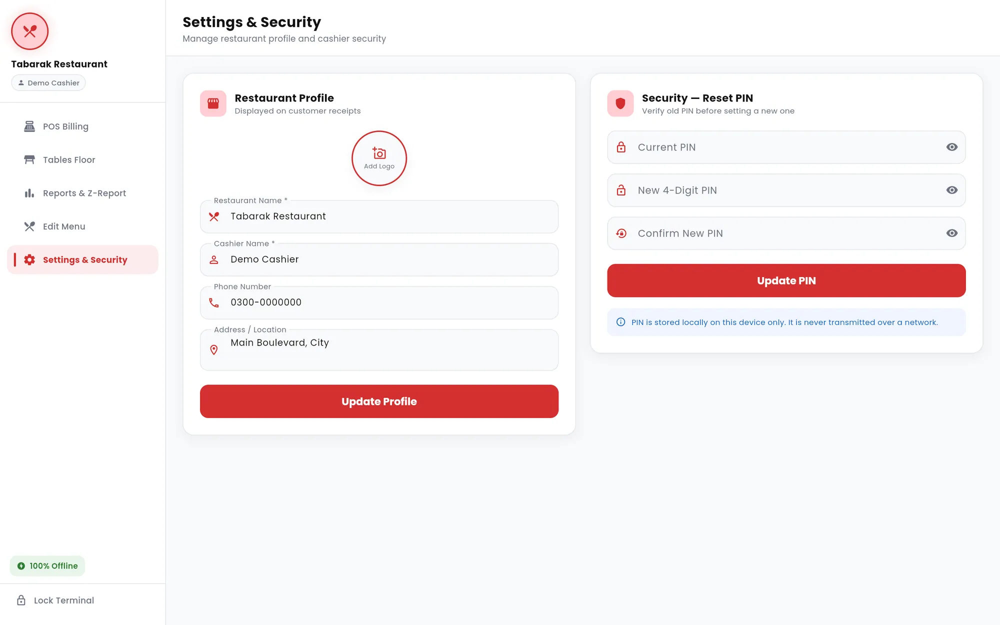

  

# Tabarak POS

**An offline-first restaurant point of sale for tablets and Windows PCs, with billing, kitchen tickets, tables, reports and thermal receipts.**

> **Portfolio showcase.** The source code is private. This repository presents the project with screenshots and a technical overview. Full case study: **[farhadnazir.com/projects/tabarak-pos](https://farhadnazir.com/projects/tabarak-pos/)**

| | |
|---|---|
| **Type** | Offline restaurant POS |
| **Categories** | Desktop app, Mobile app, Business system |
| **Platforms** | Desktop (Windows), Mobile |
| **My role** | Flutter developer at Techwine |
| **Status** | Packaged for Android and Windows |
| **Timeline** | 2026 |

## Overview

Tabarak POS is a point-of-sale app for restaurant counters. Cashiers build dine-in, takeaway and delivery orders on a touch-friendly menu, apply discounts and tax, take payment, print a kitchen ticket and hand over a thermal receipt. Around that core sit a tables floor, sales reports with a shift-closing Z-report, a menu editor and PIN-protected cashier access.

The app runs entirely on the device, with no server and no internet dependency. I built it in Flutter as a single codebase for landscape tablets and Windows PCs, then shipped it as an Android APK and as a versioned Windows installer.

**Who it is for:** Small and medium restaurants that serve dine-in, takeaway and delivery customers and need a counter POS that keeps working without internet.

## The problem

A restaurant counter cannot stop billing because the connection drops. Order entry, receipts and reports need to keep working when the internet is down, without a server in the loop.

Small restaurants also need the basics to work well at the counter: a fast menu, correct totals with discounts and tax, kitchen tickets, a view of which tables are taken, and a clean end-of-shift summary, all printed on standard 58mm or 80mm thermal rolls.

## The solution

I designed the app around one rule: everything happens locally. The menu, completed orders, table states, restaurant profile and cashier PIN are all stored on the device, so billing, printing and reporting work the same with or without a connection.

The interface is a fixed sidebar shell with five modules: POS Billing, Tables Floor, Reports and Z-Report, Edit Menu, and Settings and Security. Receipts and kitchen tickets are generated as PDFs sized to the paper roll and sent to the operating system's print pipeline, so the same printing code serves Android and Windows. Printing goes through the system print dialog rather than a direct printer driver.

## Key features

- **Touch-first billing.** Category chips, item search and colour-coded menu tiles feed a live cart with quantity controls, an order number and an item count. Orders can be dine-in with a table, takeaway, or delivery with the customer's name, phone and address.
- **Discounts, tax and change.** Flat or percentage discounts (a flat discount is capped at the subtotal), tax applied after the discount, and Cash, Card or QR payment labels. Quick chips add to the tendered amount and the app calculates the change.
- **Split bill.** A split dialog divides the grand total evenly between 2 and 20 people.
- **Kitchen order tickets.** One tap prints a numbered KOT with the items and the table or order type, without prices, so the kitchen sees only what it needs.
- **Thermal receipts with live preview.** A printer dialog switches between 58mm and 80mm rolls and shows an on-screen preview of the receipt before printing. The restaurant's name, address, phone and optional logo print on every receipt.
- **Arabic and Urdu on receipts.** Item and restaurant names in Arabic script are reshaped and reordered for right-to-left display, then rendered with a bundled Noto Naskh Arabic font so they print correctly.
- **Tables and floor plan.** Tables with seating capacity show as vacant, occupied or reserved, with the active order number on occupied tables. Staff can add or remove tables, see live status counts and reset the layout.
- **Sales reports and Z-report.** Filters for today, yesterday, week, month or all time show total sales, order count, average order value and the cash and card split. Order history supports search and reprinting, a ranking shows top-selling dishes, and a Z-report prints the shift-closing summary.
- **Menu editor.** Add, edit and delete dishes with a name, category, price, description, uploaded photo and tile colour. Changes appear on the billing screen straight away.
- **Cashier PIN and terminal lock.** A 4-digit PIN is created on first run and required to log in. Cashiers can lock the terminal from the sidebar, and changing the PIN requires the current one.

## Screenshots

<table>
<tr>
<td width="50%" valign="top"> Daily sales, order history and the shift-closing Z-report.</td>
<td width="50%" valign="top"> Choosing the roll size and previewing the receipt before printing.</td>
</tr>
<tr>
<td width="50%" valign="top"> Table status at a glance, with live vacant, occupied and reserved counts.</td>
<td width="50%" valign="top"> Managing the menu by category.</td>
</tr>
<tr>
<td width="50%" valign="top"> Receipt details and cashier PIN settings, stored only on the device.</td>
</tr>
</table>

## Architecture

Tabarak POS is a single Flutter codebase with no backend. A home shell with a fixed sidebar hosts the five modules in an IndexedStack, and the app is locked to landscape for counter tablets and desktop screens. Styling comes from one theme class of design tokens (colours, radii, shadows and the Poppins typeface).

Data lives on the device through SharedPreferences: menu items, completed orders and table states as JSON, plus the restaurant profile and the PIN. A single storage service owns all reads and writes and broadcasts a change signal so screens reload when data changes. Receipts are built with the Dart pdf package and printed through the printing package, and the Windows build is packaged with Inno Setup.

- **Offline-first local storage.** I chose JSON persistence over a database dependency. The order, menu, table and profile models all serialise to and from maps, which keeps the data layer small and easy to move between Android and Windows.
- **Reactive updates without a state library.** The storage service exposes a ValueNotifier that increments on every write. The shell listens to it and reloads the menu and profile, so an edit in the menu editor shows up on the billing screen immediately.
- **Cart survives navigation.** Because the modules sit in an IndexedStack, an order in progress stays intact while the cashier checks a table, looks up a report or edits a dish.
- **Roll-aware PDF layout.** Receipt width is set for the roll (52mm printable for 58mm paper, 74mm for 80mm), and the page height is estimated from the logo, address, phone, item count, discount and tax lines. An extra right margin stops text clipping on printers with a slightly misaligned feed.
- **Right-to-left text in PDFs.** The receipt generator detects Arabic-script characters, runs them through arabic_reshaper and bidi conversion, and falls back from Roboto to Noto Naskh Arabic so mixed English and Arabic or Urdu text renders in the right order.
- **Windows installer.** Inno Setup scripts produce an x64 installer that bundles the Flutter runtime and PDF rendering libraries, installs per user without admin rights, and adds Start Menu and desktop shortcuts. Three versioned builds were produced, 1.0.0 to 1.0.2.

## Tech stack

`Flutter` · `Dart` · `Android` · `Windows` · `Material 3` · `SharedPreferences` · `Dart pdf and printing` · `arabic_reshaper and bidi` · `image_picker` · `Inno Setup`

## Links

- Case study: https://farhadnazir.com/projects/tabarak-pos/

## About the developer

Built by **Farhad Nazir**, full-stack software developer in Riyadh, Saudi Arabia, and founder of [Techwine Solutions](https://www.techwinesolutions.com). I build SaaS platforms, business systems, and mobile and desktop apps.

[Portfolio](https://farhadnazir.com) · [LinkedIn](https://www.linkedin.com/in/farhadnazir) · [Email](mailto:farhadnazirksa@gmail.com) · [WhatsApp](https://wa.me/966536566380)

---

Screenshots are shown for portfolio purposes. Rights to each product and its branding belong to their owners. Screens marked "recreated" use demo data, so no real customer data appears.
